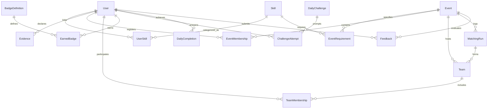

# TeamWeave Data Model Specification

**Backend ORM:** SQLModel (SQLAlchemy 2.0 + Pydantic v2)  
**Database:** SQLite for local execution, with zero-friction path to PostgreSQL  
**Module:** `backend/app/models.py`

---

## 1. Entity-Relationship Overview

---

## 2. Table Schemas

### `users`
- `id`: Integer primary key
- `email`: String (unique index)
- `hashed_password`: String (bcrypt hash)
- `full_name`: String
- `role`: String (`participant` or `organizer`)
- `bio`: Optional string
- `interests`: Optional comma-separated tags
- `preferred_roles`: Optional string
- `learning_goals`: Optional string
- `timezone`: String (default `Asia/Kolkata`)
- `created_at`, `updated_at`: UTC timestamps

### `skills`
- `id`: Integer primary key
- `name`: String (unique index, e.g., "React", "FastAPI")
- `category`: String (`frontend`, `backend`, `ai_ml`, `design`, `devops`, `product`)
- `aliases`: Optional comma-separated aliases

### `user_skills`
- `id`: Integer primary key
- `user_id`: Foreign key to `users.id`
- `skill_id`: Foreign key to `skills.id`
- `proficiency_level`: Integer (1: Exploring, 2: Developing, 3: Independent, 4: Advanced)
- `evidence_type`: String (`self_reported`, `assessment_supported`, `evidence_linked`)
- `verified`: Boolean flag

### `events`
- `id`: Integer primary key
- `organizer_id`: Foreign key to `users.id`
- `name`: String
- `description`: Optional string
- `category`: String (default `hackathon`)
- `min_team_size`, `max_team_size`: Integers (e.g. 3 and 4)
- `status`: String (`draft`, `open`, `matching`, `teams_published`, `completed`)
- `participation_mode`: String (`in_person`, `remote`, `hybrid`)

### `event_requirements`
- `id`: Integer primary key
- `event_id`: Foreign key to `events.id`
- `skill_id`: Foreign key to `skills.id`
- `priority`: String (`required` or `preferred`)
- `min_proficiency`: Integer (1–4)
- `people_needed`: Integer (default 1)
- `explanation`: Optional rationale string

### `teams`
- `id`: Integer primary key
- `event_id`: Foreign key to `events.id`
- `name`: String (e.g. "Weave Alpha")
- `status`: String (`draft`, `published`)
- `matching_run_id`: Optional foreign key to `matching_runs.id`

### `team_memberships`
- `id`: Integer primary key
- `team_id`: Foreign key to `teams.id`
- `user_id`: Foreign key to `users.id`
- `status`: String (`active`, `left`, `removed`, `waitlisted`)
- `role_in_team`: Optional string (e.g. "Frontend Engineer")
- `joined_at`, `left_at`: UTC timestamps

### `matching_runs`
- `id`: Integer primary key
- `event_id`: Foreign key to `events.id`
- `algorithm_version`: String (e.g. "greedy_v1")
- `config_snapshot`: JSON string of soft weights
- `total_participants`, `assigned_count`, `unassigned_count`, `teams_formed`: Integers
- `explanation_summary`: String summary
